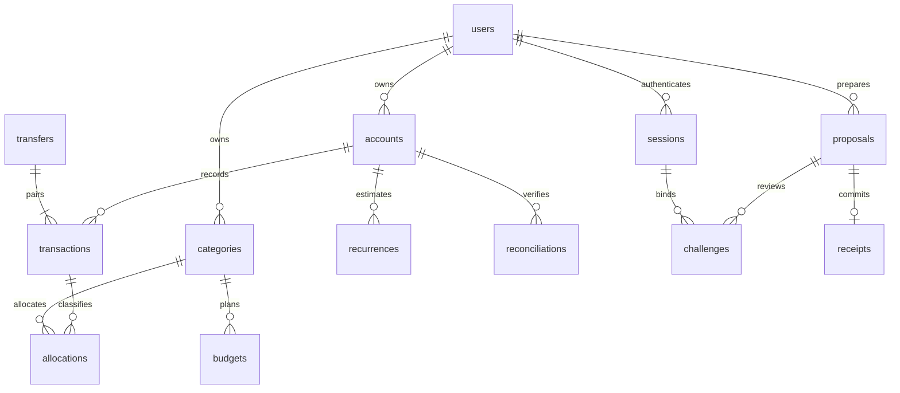

# Data model

Foreign keys enabled on every connection. WAL and `BEGIN IMMEDIATE` serialize financial commits; writes and receipt insertion roll back together.

| Table           | Invariant                                                                                  |
| --------------- | ------------------------------------------------------------------------------------------ |
| users           | Identity, password hash, preferences, financial revision; signup creates no financial rows |
| sessions        | Hashed opaque token, expiry, CSRF, owner, server-issued human/AI principal                 |
| accounts        | Immutable owner-scoped ID, custom name/type, USD, nullable opening amount, dated snapshot  |
| categories      | Immutable custom owner-scoped category                                                     |
| transactions    | Signed cleared/pending entry, composite account/owner and transfer/owner FKs               |
| allocations     | Transaction/owner and category/owner composite FKs, exact signed cents                     |
| transfers       | Pair identity; two legs inserted/deleted atomically by service                             |
| budgets         | Unique owner/category/month target separate from actuals                                   |
| recurrences     | Owner/account-linked estimated schedule; never an actual transaction                       |
| reconciliations | Statement comparison and cleared IDs; locks reconciled period                              |
| proposals       | Typed immutable operation, before snapshot, digest/version, expiry, source, owner revision |
| challenges      | Hashed single-use random token bound to owner/session/proposal/version/digest              |
| receipts        | One receipt per proposal; unique owner/idempotency key                                     |
| audit           | Approval/rejection IDs and timestamps, no raw financial payload                            |
| auth_attempts   | Hashed email identifier, attempt count and expiry                                          |

Typed JSON payloads preserve values; scalar owner/reference columns support SQL FK checks. The service atomically mirrors transaction splits into allocation rows. These local-development choices do not replace production RLS and stronger SQL constraints. Local files/drafts are not application-encrypted. Approved deletion removes canonical entries but retains the before snapshot in proposal history; soft restore remains unimplemented.
